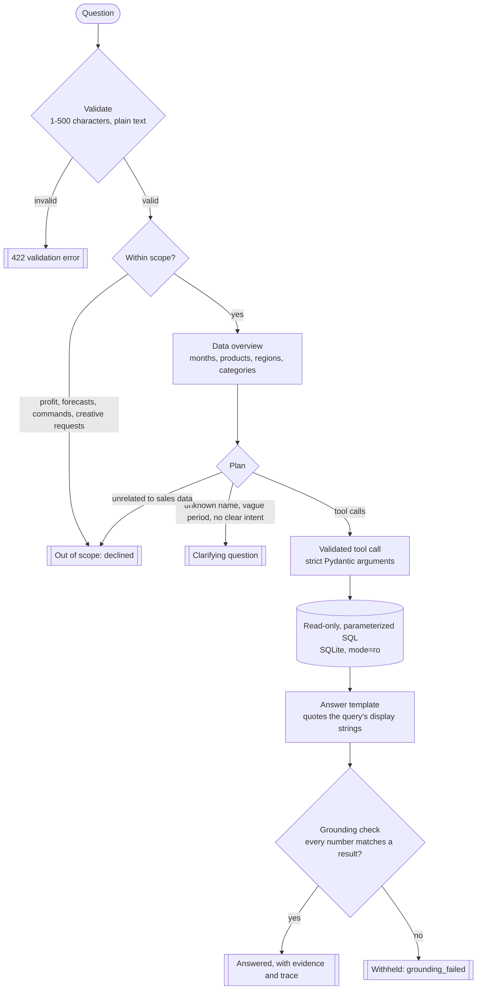
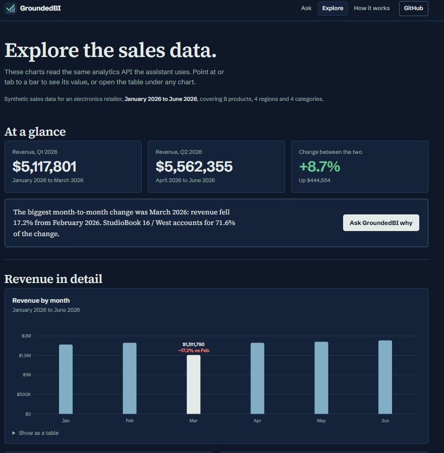
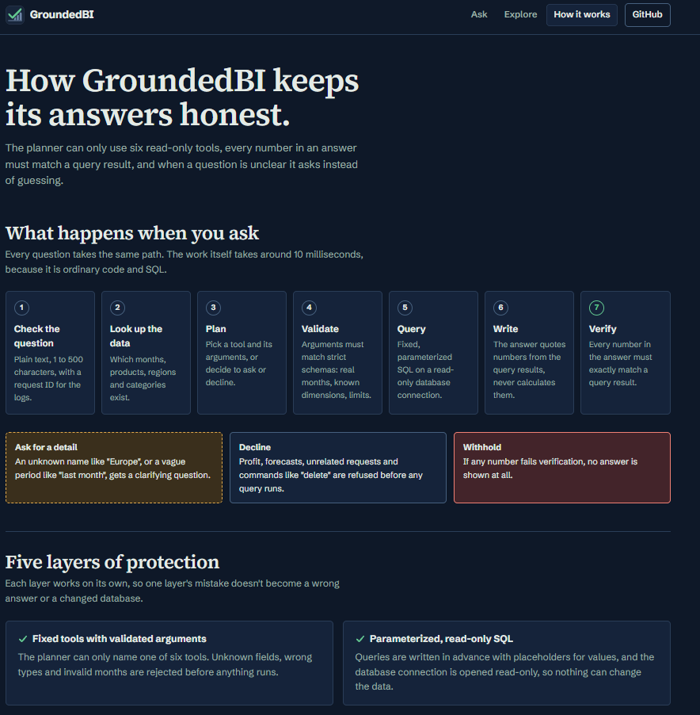

<p align="center">
  <picture>
    <source media="(prefers-color-scheme: dark)" srcset="docs/logo-dark.png">
    <source media="(prefers-color-scheme: light)" srcset="docs/logo-light.png">
    
  </picture>
</p>

<p align="center">
  A sales analytics assistant that only shows an answer when every number in it matches a query result.
</p>

<p align="center">
  <a href="https://groundedbi.vercel.app">Live demo</a> ·
  <a href="https://groundedbi.vercel.app/docs">API docs</a> ·
  <a href="evals/results/latest.md">Evaluation report</a>
  <br><br>
  <a href="https://github.com/erprakash26/groundedbi/actions/workflows/ci.yml"></a>
</p>


AI analytics assistants can state numbers confidently that no query ever produced. GroundedBI shows the guardrails that prevent that: fixed validated tools, read-only SQL, and an answer withheld unless every number matches a query result.

You ask a question about a synthetic electronics retailer's sales, such as "Why did revenue drop in March compared with February?". A planner picks from six predefined, read-only tools; their arguments are validated and their SQL is fixed and parameterized. The answer is written only from the values those queries return, and then checked: **every number in it must exactly match a query result, or the answer is withheld.** An unclear question gets a clarifying question back, and a question the data can't answer (profit, forecasts, "delete the data") is declined before any query runs.

## How it works



Every `/ask` response carries a trace of each tool call and a request ID that matches the server's structured JSON logs. Answered questions also include the evidence tables the numbers came from.

**Five layers of protection.** Each works on its own, so one layer's mistake doesn't become a wrong answer or a changed database.

1. **Fixed tools with validated arguments.** The planner can only name one of six tools. Unknown fields, wrong types and invalid months are rejected before anything runs.
2. **Parameterized, read-only SQL.** Queries are written in advance with placeholders; the only text ever inserted into SQL is a column expression picked from a fixed list. The connection is opened read-only.
3. **Limits on every question.** A maximum number of planning steps and tool calls, a deadline per question and a time budget per query. A run that hits a limit stops; it never returns a made-up answer.
4. **A grounding check on every answer.** Every number in the answer text must exactly match a value the queries returned. If one doesn't, no answer is shown.
5. **Ask instead of guess.** Unknown names ("Europe"), vague periods ("last month") and unclear requests get a clarifying question, not an assumption.

## Evaluation

The planner is measured on question sets with labelled expectations: which tools should run, with which arguments, which status the response should have, and whether the answer passes the grounding check.

- **Dev set:** used to find and fix problems. CI requires 100% on it.
- **Held-out sets:** written and labelled before any run, then only measured, never used to tune the planner. A test fails if any four consecutive words of a held-out question appear anywhere in the app's source code. Once a held-out set has been inspected, it is marked *seen* in [`evals/datasets.json`](evals/datasets.json) and its score is no longer an unbiased estimate.
- **Expected numbers** in the question files are recomputed from the analytics service on a fresh database by `evals/check_expectations.py`, so the labels themselves are checked.

A *confident wrong* answer is an answered, grounded response to a question that still failed: the worst outcome, because it looks trustworthy.

| Run | Dev | Held-out v1 | Held-out v2 | Confident wrong |
|---|---|---|---|---|
| [Baseline](https://github.com/erprakash26/groundedbi/blob/46aa0c4/evals/results/latest.md) | 21/21 | **3/10** (fresh) | not yet written | 2 (held-out v1) |
| [After the first fix round](https://github.com/erprakash26/groundedbi/blob/b117522/evals/results/latest.md) | 41/41 | 10/10 (seen) | **7/10** (fresh) | 1 (held-out v2) |
| [After the second fix round](evals/results/latest.md) | 51/51 | 10/10 (seen) | 10/10 (seen) | 0 |

After two fix rounds all 71 questions pass with no confident wrong answers, but every set has now been seen. **The last unbiased number is 7/10 on the fresh held-out v2 set**, with one confident wrong answer. Each row links to the report committed at that point.

## Security

Before public deployment the app was audited and hardened. What is in place:

| Protection | How |
|---|---|
| Read-only database | Every request opens SQLite with `mode=ro`; no request can write, change or delete data. A missing database gives a 503 and is never created. |
| Parameterized SQL | All values are `?` parameters; dimension names are checked against a fixed list. |
| Strict validation | Unknown fields rejected, no type coercion, questions limited to 500 characters, months and limits checked by pattern and range. |
| No echoed input | Error responses use one envelope and never include the submitted value or a stack trace; client request IDs are accepted only if they are plain identifiers, so they can't forge log lines. |
| Web pages | A strict Content-Security-Policy (same-origin scripts and styles only, no inline code), `nosniff` on every response, `no-referrer`. Text is inserted with `textContent`, never parsed as HTML; tests enforce it. |
| Body limit | Request bodies over 16 KB get a 413, whether or not a `Content-Length` was sent. |
| Caching | Successful read-only GETs are cacheable by browsers and the CDN; errors and `/ask` answers are `no-store`. |
| Dependencies | Direct runtime and dev dependencies are pinned; the full resolved set is audited with `pip-audit` in CI on every push. |

Rate limiting is left to the host (for example a Vercel Firewall rule): an in-memory limiter doesn't hold across several serverless instances. The app logs questions but not IP addresses (the hosting provider's own logs may record them), and the Ask page says so.

## Screenshots

**Explore:** stat tiles and charts drawn from the same analytics API the assistant uses, with a link that asks the assistant about the biggest change.



**How it works:** the request path and the five layers, explained on the site.



## Tech stack

| Area | Tools |
|---|---|
| Backend | Python 3.11 / 3.12, FastAPI, Pydantic, pydantic-settings |
| Data | SQLite with a synthetic, seeded dataset (6 months, 8 products, 4 regions, 4 categories) |
| Frontend | Plain HTML, CSS and JavaScript, served by the app; no framework, no build step |
| Testing | pytest, an evaluation suite with dev and held-out sets, `pip-audit` |
| CI and hosting | GitHub Actions (Python 3.11 and 3.12), Vercel |

## Project structure

```
app/
  api/            HTTP routes, error envelope, caching and body-limit middleware
  services/       orchestrator, grounding check, analytics and coverage logic
  tools/          the six tools: argument models, definitions, executor
  llm/            provider interface and the rule-based planner
  db/             schema, read-only connection, parameterized queries
  schemas/        Pydantic request and response models
  observability/  request IDs, structured JSON logging, access log
  web/            the website: three pages, scripts, styles, fonts
scripts/          seed_data.py: builds the synthetic database
evals/            question sets, scoring, eval runner, committed report
tests/            pytest suite
docs/             logos, screenshots, design notes
.github/workflows CI
```

## Run locally

Python 3.11 or 3.12. On Windows PowerShell:

```powershell
python -m venv .venv
.\.venv\Scripts\Activate.ps1          # macOS/Linux: source .venv/bin/activate
python -m pip install -r requirements-dev.txt
python -m scripts.seed_data           # creates data/groundedbi.db
uvicorn app.main:app --reload         # http://127.0.0.1:8000
```

`requirements-dev.txt` installs the runtime packages (`requirements.txt`) plus pytest, httpx2 and pip-audit. Without the seed step every data endpoint answers 503.

The checks CI runs:

```powershell
pip-audit -r requirements-dev.txt
python -m pytest -v
python -m evals.check_expectations
python -m evals.run_evals --split dev --fail-under 1.0
```

`run_evals` rewrites `evals/results/latest.md`; restore it with `git checkout -- evals/results/latest.md` if you don't mean to update the report.

## Deploy

On Vercel, [`vercel.json`](vercel.json) builds the database during the build (`python -m scripts.seed_data --db data/groundedbi.db`) and leaves `tests/`, `evals/` and `docs/` out of the function bundle. Vercel installs `requirements.txt` on the Python version in [`.python-version`](.python-version).

Any other host works with a build command and a start command:

```
build:  python -m pip install -r requirements.txt && python -m scripts.seed_data
start:  uvicorn app.main:app --host 0.0.0.0 --port $PORT
```

If the database is missing, the app still starts, logs `database_unavailable` and answers 503 on the data endpoints.

## Limitations

- **Rule-based planner.** Questions are planned by deterministic rules, not a language model, and no model is called. The provider interface is model-neutral, so a model-backed planner could plug in without changing the orchestrator or the tools.
- **Synthetic data.** Six months of generated sales for one fictional retailer, with planted patterns to explain.
- **Numbers are checked, words are not.** The grounding check verifies every number against the query results; the sentence around them comes from fixed templates and is not verified separately. Direction words such as rose and fell are chosen in code from the sign of the change, and that rule is tested separately, including questions with a false premise.
- **Rounded displays.** Answers quote whole-dollar display strings; the evidence keeps exact integer cents.

## What's next

- Plug in a model-backed planner behind the existing provider interface and evaluate it on a fresh held-out set.
- Write held-out v3 to measure the current rules on unseen wording.
- Add a host-level rate-limit rule.

## License and author

[MIT](LICENSE). Built by [Prakash Bhandari](https://github.com/erprakash26).

Built with Claude Code as a coding assistant. I set the requirements and design decisions, reviewed each change, and verified results with the tests and evaluations.
